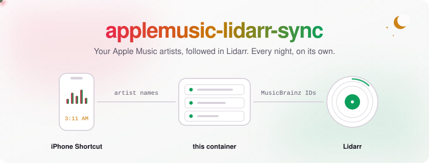
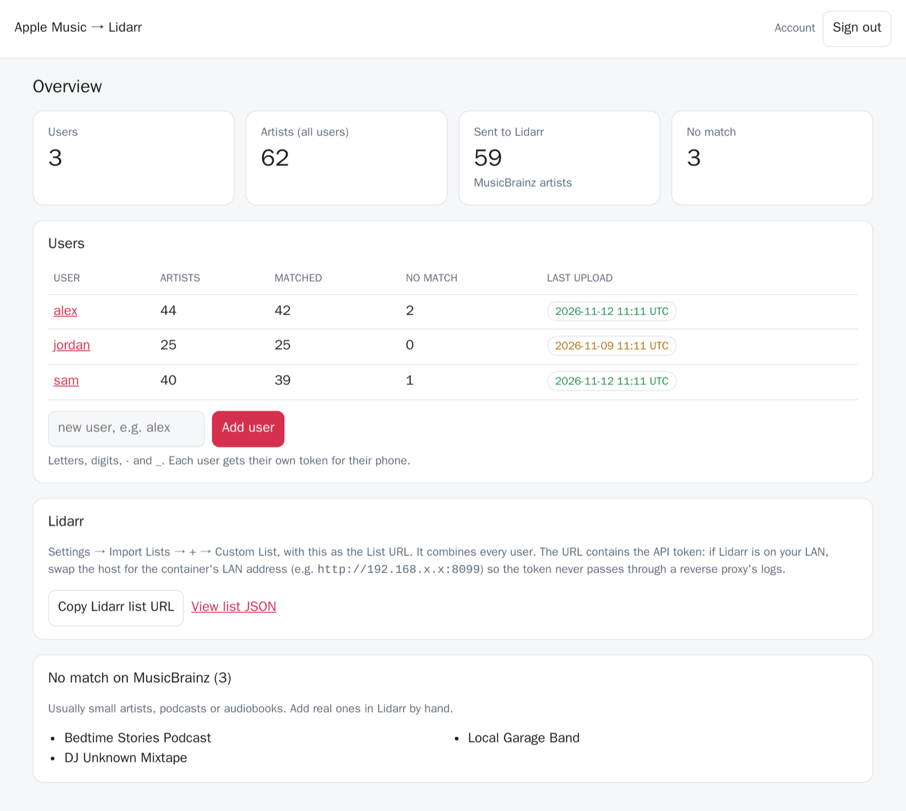
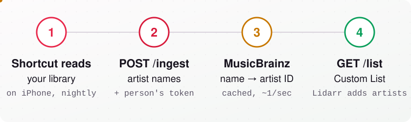
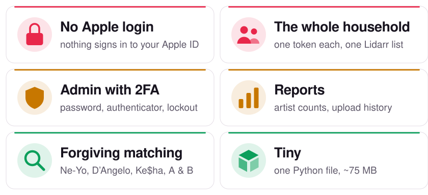
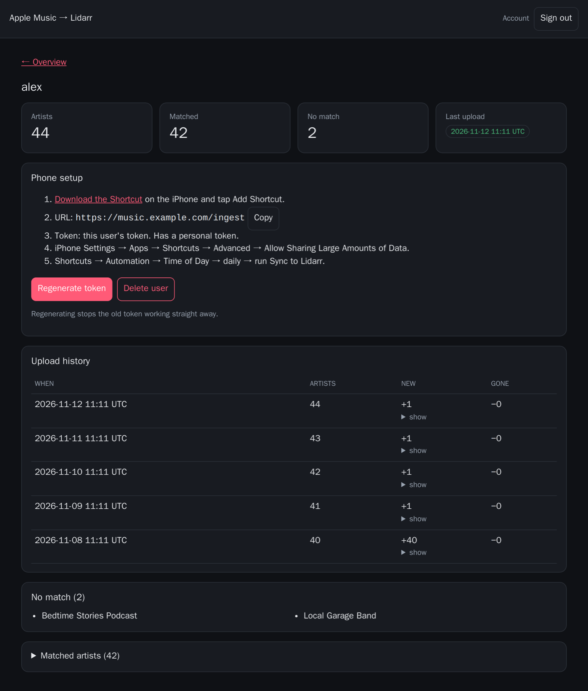
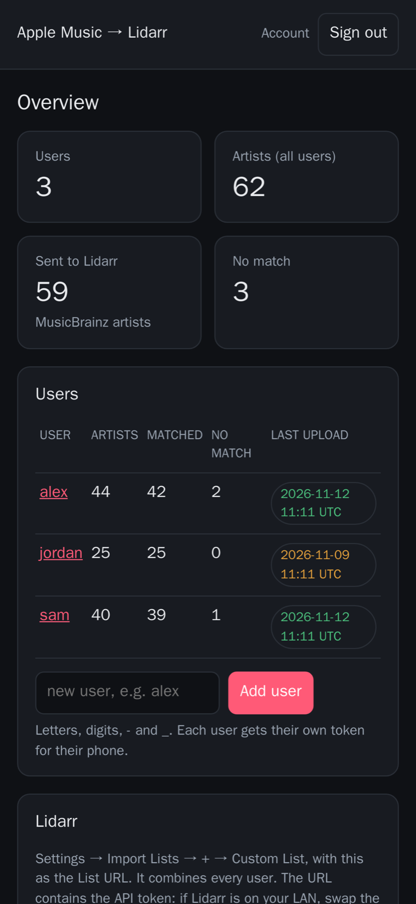

<picture>
  <source media="(prefers-color-scheme: dark)" srcset="docs/banner-dark.svg">
  <source media="(prefers-color-scheme: light)" srcset="docs/banner-light.svg">
  
</picture>

<p align="center">
  <a href="https://github.com/egamer24/applemusic-lidarr-sync/releases"></a>
  <a href="https://github.com/egamer24/applemusic-lidarr-sync/pkgs/container/applemusic-lidarr-sync"></a>
  
  <a href="LICENSE"></a>
</p>

<p align="center">
  <strong>Keep <a href="https://lidarr.audio">Lidarr</a> following the artists in your Apple Music library.</strong><br>
  No Mac, no Apple Developer account, and nothing ever signs in to your Apple ID.
</p>

<p align="center">
  <a href="#quick-start">Quick start</a> &bull;
  <a href="#run-it">Run it</a> &bull;
  <a href="#the-iphone-shortcut">Shortcut</a> &bull;
  <a href="#add-it-to-lidarr">Lidarr</a> &bull;
  <a href="#access-and-remote-use">Remote use</a> &bull;
  <a href="#faq">FAQ</a>
</p>

<br>

<picture>
  <source media="(prefers-color-scheme: dark)" srcset="docs/dashboard-dark.png">
  
</picture>

<picture>
  <source media="(prefers-color-scheme: dark)" srcset="docs/divider-dark.svg">
  <source media="(prefers-color-scheme: light)" srcset="docs/divider-light.svg">
  
</picture>

## How it works

<picture>
  <source media="(prefers-color-scheme: dark)" srcset="docs/steps-dark.svg">
  <source media="(prefers-color-scheme: light)" srcset="docs/steps-light.svg">
  
</picture>

An iPhone Shortcut reads your library on the phone (with Apple's own Shortcuts actions) and posts the artist names to this small container every night. The container matches them on MusicBrainz and serves them to Lidarr as a Custom List, so new artists you add in Apple Music show up in Lidarr on their own. One container serves a whole household.

## Features

<picture>
  <source media="(prefers-color-scheme: dark)" srcset="docs/features-dark.svg">
  <source media="(prefers-color-scheme: light)" srcset="docs/features-light.svg">
  
</picture>

<details>
<summary><strong>Feature details</strong></summary>

- **No Apple login, no Mac, no developer account.** The phone sends artist names; that's all. It stays within Apple's terms.
- **Several people, one Lidarr list.** Each person gets their own token; Lidarr gets everyone's artists combined, each once.
- **Web admin** with first-run setup, username + password, optional **two-factor** (authenticator app + recovery codes) and a sign-in lockout.
- **Reports:** per-person artist counts, last upload (flags phones that stopped syncing), upload history with added/removed artists, and the names MusicBrainz couldn't match.
- **Good matching:** handles typographic punctuation (`Ne‐Yo`, `D’Angelo`), `$` (`Ke$ha`), spacing (`Cee Lo Green` → `CeeLo Green`) and collaborations (`A & B`, `A feat. B`).
- **Tiny:** one Python file, standard library only, ~75 MB image for `amd64` and `arm64`.
- **Runs anywhere:** Docker / Compose, [Unraid](#run-it) and [CasaOS](#run-it) templates included.

</details>

<picture>
  <source media="(prefers-color-scheme: dark)" srcset="docs/divider-dark.svg">
  <source media="(prefers-color-scheme: light)" srcset="docs/divider-light.svg">
  
</picture>

## Quick start

1. Run the container (below) and open `http://<host>:8099`. Create the admin account with the **setup code** from `docker logs applemusic-lidarr-sync`.
2. In **Settings**, enter your **external URL** (for phones away from home) and/or **internal URL** (home network; Lidarr uses it). Optional, but then nobody types an address.
3. **Add user** for each person. Their page shows a **setup code** (upload address + their token, one line) with a copy button. Send it to them privately.
4. On each iPhone: open `http://<host>:8099/shortcut`, tap **Add Shortcut**, and paste the setup code when it asks. Turn on **Settings → Apps → Shortcuts → Advanced → Allow Sharing Large Amounts of Data**, run it once, then add a daily **Time of Day** automation.
5. In Lidarr: **Settings → Import Lists → + → Custom List**, List URL from the dashboard's **Copy Lidarr list URL** button (it uses your internal URL when set).

> [!TIP]
> Phones away from home? See [Access and remote use](#access-and-remote-use).

<table>
<tr>
<td width="68%" valign="top"></td>
<td width="32%" valign="top"></td>
</tr>
</table>

## Run it

```yaml
services:
  applemusic-lidarr-sync:
    image: ghcr.io/egamer24/applemusic-lidarr-sync:latest
    container_name: applemusic-lidarr-sync
    environment:
      TOKEN: change-me   # optional; long random string, e.g. `openssl rand -hex 24`
    ports:
      - "8099:8080"
    volumes:
      - data:/data
    restart: unless-stopped
volumes:
  data:
```

Prefer a host folder? `./data:/data` works as is: the container starts as root only long enough to give `/data` to `PUID:PGID` (default `1000:1000`), then drops root before doing anything else. Set `PUID`/`PGID` to match your other apps, or run with `user: 1000:1000` and skip that step entirely.

<table>
<tr>
<td width="50%" valign="top">

**Unraid:** a template is in [`unraid/applemusic-lidarr-sync.xml`](unraid/applemusic-lidarr-sync.xml) (Docker → Add Container → Template URL: `https://raw.githubusercontent.com/egamer24/applemusic-lidarr-sync/main/unraid/applemusic-lidarr-sync.xml`). It runs as `99:100` (nobody:users) like other Unraid apps.

</td>
<td width="50%" valign="top">

**CasaOS:** App Store → **Custom Install** → **Import** (top right) and paste [`casaos/docker-compose.yml`](casaos/docker-compose.yml). Data goes to `/DATA/AppData/applemusic-lidarr-sync/data`; the setup code is in the app's logs.

</td>
</tr>
</table>

<details open>
<summary><strong>Environment variables</strong></summary>

| Variable | Default | |
|---|---|---|
| `TOKEN` | generated | API token for Lidarr's `/list` (and admin uploads). If unset, one is generated and stored in `state.json`; the GUI shows the full Lidarr URL either way |
| `PUID` / `PGID` | `1000` | User and group the app runs as; it takes ownership of `/data` on start. `0` is refused |
| `RESET_ADMIN` | off | `true` deletes the admin account on start so you can run setup again (forgotten password). Remove it afterwards |
| `PORT` | `8080` | Port inside the container |
| `DATA_DIR` | `/data` | Where `state.json` (artist list + lookup cache) lives |
| `MB_USER_AGENT` | project URL | MusicBrainz asks every client to identify itself |

</details>

<picture>
  <source media="(prefers-color-scheme: dark)" srcset="docs/divider-dark.svg">
  <source media="(prefers-color-scheme: light)" srcset="docs/divider-light.svg">
  
</picture>

## Web GUI

On first visit the GUI asks you to **set up an admin account** (username + password). Setup also asks for a **setup code** so nobody else can claim the admin account first: it's printed in the container log (`docker logs applemusic-lidarr-sync`), or use your `TOKEN`. After that you sign in with the username and password; **Account** changes the password (and signs out other browsers).

**Two-factor sign-in** (Account → Set up two-factor): standard 6-digit authenticator codes (TOTP: iPhone Passwords, Google Authenticator, 1Password, …) plus 8 one-time recovery codes. Each code works once. Ten failed sign-in steps in 15 minutes lock sign-in for 15 minutes. Lost both phone and recovery codes? Set `RESET_ADMIN=true`, restart, and set up again.

From there you can:


- **Add users.** Each gets a personal token, shown once with copy buttons. Regenerate or delete it any time.
- **See reports:** totals, each user's artist count, matches and last upload (amber when it's over 36 hours old), plus per-user upload history with the artists that were added or removed, unmatched names, and matched artists linked to MusicBrainz.
- **Copy the Lidarr list URL** and **download the Shortcut** (`/shortcut`, public, it holds no secrets).

<details>
<summary><strong>Security notes</strong></summary>

- `state.json` (mode 600) holds the password hash, the 2FA secret and the cookie signing key. Back it up like a password file.
- User tokens are stored only as SHA-256 hashes and shown once.
- The Lidarr list URL carries the API token in its query string, so give Lidarr the container's **LAN** address; through a reverse proxy the token would be written to the proxy's access log.

</details>

## Endpoints

| | Auth | |
|---|---|---|
| `POST /ingest` | user token, or API token + `?user=<name>` (default `default`) | Body: one artist per line, a JSON array, or `{"artists": [...]}`. Replaces that user's list |
| `GET /list` | API token (or signed in) | Lidarr Custom List JSON, every user combined |
| `GET /` | signed in | Web GUI (`/setup` on first run, `/login`, `/account`) |
| `GET /shortcut` | none | The iPhone Shortcut |
| `GET /healthz` | none | Health check |

Tokens go in `Authorization: Bearer <token>` or `?token=<token>`.

MusicBrainz allows about one lookup per second, so the first upload of a big library takes a while (the status page shows an estimate). Results are cached, so later uploads only look up new names.

<picture>
  <source media="(prefers-color-scheme: dark)" srcset="docs/divider-dark.svg">
  <source media="(prefers-color-scheme: light)" srcset="docs/divider-light.svg">
  
</picture>

## Access and remote use

### Who needs to reach what

| Path | Used by | Needs to be reachable from |
|---|---|---|
| `/ingest` | each iPhone's Shortcut | wherever the phone is when the automation runs |
| `/shortcut` | new users installing the Shortcut | their phone, once |
| `/`, `/login`, `/account`, `/u/…` | you (admin GUI) | wherever you manage it from; LAN is enough for most people |
| `/list` | Lidarr | **LAN only** (Lidarr runs next to it) |
| `/healthz` | monitoring | wherever your monitor runs |

How each one is protected:

- `/ingest` needs a user's token in the `Authorization` header. A token can only replace that user's own artist list. It can't read anything, open the GUI or touch other users.
- The GUI needs the admin username, password and (if on) a 2FA code, with a lockout after 10 failures in 15 minutes.
- `/list` needs the API token. Lidarr can only send it in the URL, which is why it should stay on the LAN.
- `/shortcut` and `/healthz` are public on purpose; the Shortcut file contains no URL or token.

### Pick a way to reach it

**1. LAN only (simplest).** Don't expose it. Set each phone's automation for a time it's normally at home on Wi-Fi (e.g. 3 AM, charging), with the URL `http://<LAN-address>:8099/ingest`. A run while away from home just fails and the next night catches up. Fine for one household.

**2. VPN (most private).** Put the server and the phones on Tailscale, WireGuard, or your router's VPN, and use the VPN address in the Shortcut. Nothing is on the public internet. iOS VPNs must be connected (or on-demand) when the automation runs; Tailscale's always-on mode works well.

**3. Reverse proxy with HTTPS (best for remote users without a VPN).** Put it behind Caddy, Nginx Proxy Manager, Traefik or plain nginx with a real certificate. Recommended:

- **Always HTTPS.** Tokens and passwords travel in headers and forms; plain HTTP over the internet exposes them. Turn on "force SSL" / HTTP→HTTPS redirect.
- **Pass `X-Forwarded-Proto` and `Host`** (all the proxies above do by default). The app uses them to mark sign-in cookies `Secure` and to show the right URLs.
- **Only expose what remote phones need**: `/ingest`, `/shortcut`, `/healthz`. Keep the GUI and `/list` LAN-only unless you need to manage it remotely (it's protected by password + 2FA if you do).
- **Never put a token in a link through the proxy.** Proxies log full URLs; that's why Lidarr should use the LAN address.
- **Turn on 2FA** under Account before exposing the GUI.

<details>
<summary><strong>Caddy and nginx examples (phones get /ingest, the rest stays on the LAN)</strong></summary>

Caddy, exposing only what phones need and keeping the rest LAN-only:

```caddyfile
music.example.com {
    @phones path /ingest /shortcut /healthz
    handle @phones {
        reverse_proxy applemusic-lidarr-sync:8080
    }
    @lan remote_ip private_ranges
    handle @lan {
        reverse_proxy applemusic-lidarr-sync:8080
    }
    respond 404
}
```

Plain nginx (or Nginx Proxy Manager's **Advanced** tab), same idea:

```nginx
location ~ ^/(ingest|shortcut|healthz)$ {
    proxy_pass http://applemusic-lidarr-sync:8080;
    proxy_set_header Host $host;
    proxy_set_header X-Forwarded-Proto $scheme;
    client_max_body_size 20m;
}
location / {
    allow 10.0.0.0/8; allow 172.16.0.0/12; allow 192.168.0.0/16; deny all;
    proxy_pass http://applemusic-lidarr-sync:8080;
    proxy_set_header Host $host;
    proxy_set_header X-Forwarded-Proto $scheme;
}
```

</details>

If you'd rather expose everything (simplest NPM setup: one proxy host, scheme `http`, forward to the container, request a Let's Encrypt certificate, Force SSL on), that works too; the GUI is behind password + 2FA and `/list` still needs the API token. Just don't point Lidarr at the public address.

**4. Cloudflare Tunnel.** Works without opening ports. Two catches: Cloudflare Access login pages block the Shortcut (it can't sign in), so either leave `/ingest` and `/shortcut` outside Access, or create an Access **service token** and add its `CF-Access-Client-Id` and `CF-Access-Client-Secret` headers to the Shortcut's **Get Contents of URL** action. And keep `/list` off the tunnel; Lidarr should use the LAN address.

### Remote users checklist

1. Add them in the GUI and send them their token privately (password manager share, Signal, etc.), not in a group chat or email thread.
2. They install the Shortcut from `https://<your-host>/shortcut`, enter `https://<your-host>/ingest` and their token.
3. They turn on **Allow Sharing Large Amounts of Data** and set a daily automation.
4. Watch their row on the dashboard: the last-upload badge turns amber after 36 hours without an upload.
5. If a phone is lost or a token leaks: open the user, **Regenerate token**. The old one stops working at once.

## Several people, one server

Add each person in the web GUI and give them their own token. An upload only replaces that person's list, and `/list` gives Lidarr everyone's artists combined (each artist once), so one Lidarr Custom List covers the whole household.

<picture>
  <source media="(prefers-color-scheme: dark)" srcset="docs/divider-dark.svg">
  <source media="(prefers-color-scheme: light)" srcset="docs/divider-light.svg">
  
</picture>

## The iPhone Shortcut

**Quick way:** open [`shortcut/Sync to Lidarr.shortcut`](shortcut/Sync%20to%20Lidarr.shortcut) on your iPhone and tap **Add Shortcut**. It asks for one thing: your **setup code** from the web GUI (`<url>/ingest <token>`), and splits it into the address and token itself. It's also served by the container at `/shortcut`. It sends every album artist in your library; edit the **Find Music** action to narrow it down.

(`shortcut/build.py` generates it; sign on a Mac with `shortcuts sign --mode anyone`.)

<details>
<summary><strong>Or build it yourself in the Shortcuts app</strong></summary>

1. **Find Music**. Leave it as all music, or add a filter (for example a playlist, or **Is Loved** if your iOS version offers it) to send only part of your library.
2. **Get Details of Music** → **Album Artist**. Album Artist avoids most "feat." credits; **Artist** also works.
3. **Combine Text** with **New Lines**.
4. **Get Contents of URL**
   - URL: `https://your-host/ingest`
   - Method: **POST**
   - Headers: `Authorization` = `Bearer <your token>`
   - Request Body: **File** → *Combined Text*

</details>

Run it once and check the user's page in the web GUI (last upload, artist count). iOS blocks Shortcuts from sending large libraries until you turn on **Allow Sharing Large Amounts of Data** (Settings → Apps → Shortcuts → Advanced; on iOS 17 and earlier, Settings → Shortcuts → Advanced). See the [FAQ](#faq).

Then in **Automation → New Automation → Time of Day**, choose daily and **Run Immediately**, and pick this Shortcut.

After creating the automation, tap ▶ in it once with the phone unlocked and answer every prompt with **Always Allow**. Otherwise the 3 AM run fails while the phone is locked; see the [FAQ](#faq).

The phone has to reach `/ingest` when the automation runs; see [Access and remote use](#access-and-remote-use).

> [!IMPORTANT]
> Two one-time iPhone settings, or the nightly run fails: turn on **Allow Sharing Large Amounts of Data**, and run the automation once by hand, answering every prompt with **Always Allow**. Both are in the [FAQ](#faq).

## Add it to Lidarr

**Settings → Import Lists → + → Custom List**

- List URL: `http://<container-LAN-address>:8099/list?token=<API token>` (the dashboard's **Copy Lidarr list URL** button gives you this; swap in the LAN address if it shows your public one)
- Pick the root folder, quality profile and monitoring you want for new artists.

Lidarr refreshes custom lists every 6 hours at most. Removing an artist from your library drops it from the list but doesn't delete it from Lidarr unless you set Lidarr's "List Clean Library Level".

## Limits

- Artists are matched by name only. When several artists share a name, MusicBrainz's best match wins, which is usually the well-known one. Check the GUI's "No match" list for names to fix in Lidarr by hand.
- Collaborations like `A & B` or `A feat. B` are looked up as a whole first, then split into parts.

<picture>
  <source media="(prefers-color-scheme: dark)" srcset="docs/divider-dark.svg">
  <source media="(prefers-color-scheme: light)" srcset="docs/divider-light.svg">
  
</picture>

## FAQ

<details>
<summary><strong>Does it need my Apple ID or an app-specific password?</strong></summary>

No. App-specific passwords only work for iCloud mail, contacts and calendars, and logging in to Apple Music from a server would break Apple's terms. The Shortcut runs on your phone with Apple's own actions and only sends artist names.

</details>
<details>
<summary><strong>Android / Apple Music on Windows?</strong></summary>

Not yet: it relies on iOS Shortcuts. Anything that can POST one artist name per line to `/ingest` with a token works, so other sources are possible.

</details>
<details>
<summary><strong>The Shortcut says it's "This action is trying to share N Music items, which is not allowed".</strong></summary>

iOS caps how many items a Shortcut may send unless you turn on **Allow Sharing Large Amounts of Data**:

- iOS 18 and later: **Settings → Apps → Shortcuts → Advanced**
- iOS 17 and earlier: **Settings → Shortcuts → Advanced**

Confirmed on iOS 27 with a 1,421-song library (the run is blocked and the upload never happens). The switch has been in Shortcuts' Advanced settings across several iOS versions; we haven't pinned down the exact item limit or which versions enforce it, so turn it on whatever version you're on. If you hit it on another iOS version, an issue saying which one helps.

</details>
<details>
<summary><strong>The automation fails with "This shortcut requires privacy permissions that cannot be granted while your device is locked".</strong></summary>

The Shortcut still has a permission set to *Ask* (Apple Music access, or connecting to your server), and iOS can't show the prompt on a locked phone. With the phone unlocked, open the automation, tap ▶, and choose **Always Allow** on every prompt (not *Allow Once*). Then check the Shortcut's ⓘ → **Privacy**: Apple Music and your server's address should both be allowed. Run ▶ once more; if it finishes without a prompt, the nightly run works while the phone is locked.

</details>
<details>
<summary><strong>It says `no artist names in body`.</strong></summary>

Open the Shortcut: in **Get … from Music** and **Combine**, the input must be the previous action's result (blue bubble), not greyed out.

</details>
<details>
<summary><strong>Will Lidarr download everything?</strong></summary>

That's Lidarr's choice, set on the Custom List: *Monitor* (none / specific / entire artist) and *Search for New Items*. Start with *None* if your library is big.

</details>
<details>
<summary><strong>Why didn't an artist match?</strong></summary>

MusicBrainz doesn't have it, or it's a podcast/audiobook. Unmatched names are listed in the GUI; add real ones in Lidarr by hand. Same-name artists resolve to MusicBrainz's best match.

</details>
<details>
<summary><strong>I removed an artist from Apple Music. Does Lidarr delete it?</strong></summary>

Only if you set Lidarr's *List Clean Library Level*.

</details>
<details>
<summary><strong>Forgot the admin password?</strong></summary>

Set `RESET_ADMIN=true`, restart, set up again, then remove the variable. Users, tokens and lists are kept.

</details>

## Versions and updates

`MAJOR.MINOR.PATCH`: patch releases (1.0.**1**) are fixes, docs and packaging; minor releases (1.**1**.0) add features without changing existing setups; major releases (**2**.0.0) need you to change something. See [CHANGELOG.md](CHANGELOG.md).

Image tags: `:latest`, an exact version like `:1.0.1`, or `:1.0` to get patch fixes automatically without feature updates. The running version is shown at the bottom of the admin pages.

## Development

```
docker build -t applemusic-lidarr-sync .
docker run --rm -v "$PWD:/src" -w /src --entrypoint python applemusic-lidarr-sync test_app.py
```

Releasing: bump `VERSION` in `app.py`, add a CHANGELOG entry, push, then tag `vX.Y.Z` (e.g. `gh release create v1.0.2`). The build refuses a tag that doesn't match `VERSION`.

<br>

<picture>
  <source media="(prefers-color-scheme: dark)" srcset="docs/divider-dark.svg">
  <source media="(prefers-color-scheme: light)" srcset="docs/divider-light.svg">
  
</picture>

<p align="center"><sub>MIT licensed. Not affiliated with or endorsed by Apple, Lidarr or MusicBrainz. Apple Music is a trademark of Apple Inc.</sub></p>
